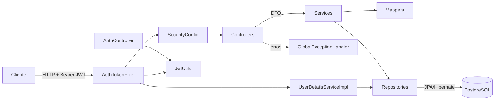
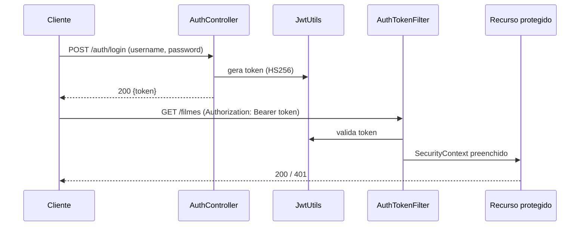

# 🎬 Techback

API REST em **Spring Boot** com CRUD de Filmes, Funcionários e Usuários, autenticação **JWT** e controle de concorrência por **lock otimista**.
Projeto da disciplina *Tecnologias para Backend (Spring Boot)* — UNIESP, sobre a base do Prof. Rodrigo Fujioka.


[](https://github.com/josewilson/Atividade-CRUD_Projeto_Techback/actions/workflows/ci.yml)


## ✨ Funcionalidades

- CRUD completo de **Filmes**, **Funcionários** e **Usuários**
- Autenticação **stateless com JWT** (`/auth/login`) e senhas com **BCrypt**
- **Lock otimista** (`@Version`) com resposta `409 Conflict` em edições concorrentes
- Validação de entrada (Bean Validation) e tratamento global de erros
- Documentação interativa via **Swagger UI**
- Testes de controller, service, repository e mapper

## 🏗️ Arquitetura



**Fluxo de autenticação**



### Estrutura de pastas

```
src/main/java/br/uniesp/si/techback/
├── controller/   # REST: Auth, Filme, Funcionario, Usuario + GlobalExceptionHandler
├── service/      # Regras de negócio + UserDetailsServiceImpl
├── repository/   # Spring Data JPA
├── model/        # Entidades JPA (Usuario, Filme, Funcionario, ...)
├── dto/          # Objetos de transferência e validação
├── mapper/       # Entity <-> DTO
├── security/     # JwtUtils, AuthTokenFilter, SecurityConfig
└── TechbackApplication.java
src/test/java/... # controller, service, repository, mapper
```

## 🚀 Como executar

### Docker (recomendado)

```bash
cp .env.example .env   # preencha JWT_SECRET (openssl rand -hex 64), DB_PASSWORD e ADMIN_PASSWORD
docker compose up --build
```

A API sobe em <http://localhost:8080>, com PostgreSQL 16 e migrações **Flyway** aplicadas automaticamente. O usuário `admin` é criado na primeira subida com a senha de `ADMIN_PASSWORD`.

### Local com H2 (perfil `dev`)

```bash
export JWT_SECRET="$(openssl rand -hex 64)"
./mvnw spring-boot:run -Dspring-boot.run.profiles=dev
```

| Variável | Obrigatória | Padrão | Descrição |
|---|---|---|---|
| `JWT_SECRET` | ✅ | — | Chave de assinatura HS256 (mín. 32 caracteres) |
| `DB_URL`, `DB_USER`, `DB_PASSWORD` | ✅ (exceto `dev`) | — | Conexão PostgreSQL |
| `JWT_EXPIRATION_MS` | ❌ | `3600000` | Validade do token (1 h) |
| `ADMIN_EMAIL` / `ADMIN_PASSWORD` | ❌ | `admin.com` / — | Admin inicial (só criado se a senha for definida) |

Swagger UI: <http://localhost:8080/swagger-ui/index.html>

## 🔐 Endpoints

| Método | Rota | Acesso |
|---|---|---|
| POST | `/auth/login` | Público |
| POST | `/usuarios` | Público (cadastro) |
| GET/PUT/DELETE | `/usuarios/**` | Autenticado |
| CRUD | `/filmes` | Autenticado |
| CRUD | `/funcionarios` | Somente `ADMIN` |

```bash
TOKEN=$(curl -s -X POST localhost:8080/auth/login \
  -H 'Content-Type: application/json' \
  -d '{"username":"admin","password":"<senha>"}' | jq -r .token)

curl -H "Authorization: Bearer $TOKEN" localhost:8080/filmes
```

## 🧪 Testes

```bash
./mvnw test   # inclui testes de integração com Testcontainers (requer Docker)
```

Relatório de cobertura (JaCoCo) em `target/site/jacoco/index.html`.

## 🔒 Segurança

- Segredo JWT somente via variável de ambiente
- Rotas de usuários protegidas; senha nunca é retornada nas respostas
- Schema versionado com Flyway (`ddl-auto=validate`); console H2 só no perfil `dev`
- Admin criado via `ADMIN_PASSWORD`; nenhuma senha ou hash versionado

## 👥 Integrantes

Veja [INTEGRANTES.md](INTEGRANTES.md).
